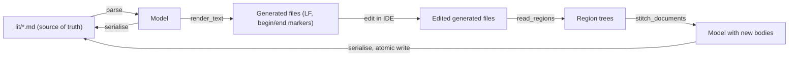
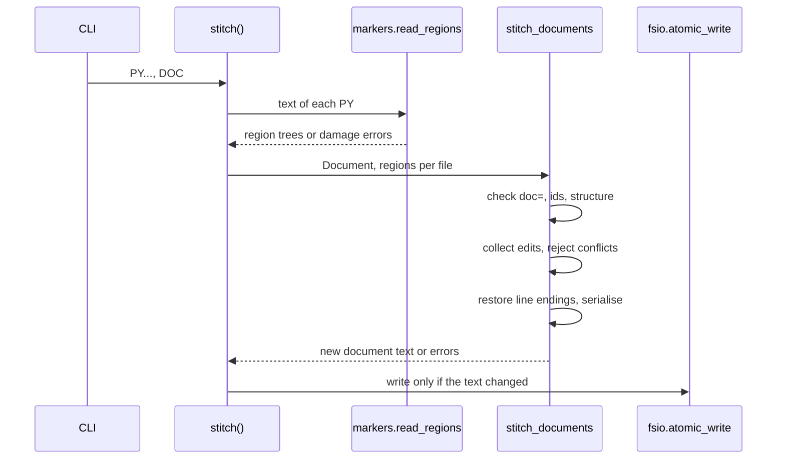

# Design Document

## Overview

This feature makes the literate document format, `lit tangle` and `lit stitch` lossless. A document is parsed into an ordered model of prose and identified chunks. Tangle writes ordinary `.py` files with paired `begin`/`end` region markers. Stitch reads edited regions back into chunk bodies. The round trip is stated as Hypothesis property tests.

A working implementation exists (`lit/format.md`, `lit/tangle.md`, `lit/stitch.md`, `lit/cli.md`, tests under `tests/`). It was written under the bootstrap exception, which `SESSION_HISTORY.md` records as over. This design therefore describes what must change in that implementation, and what stays.

### Working mode (literate-first)

Every `src/literacode/*.py` file is generated. All changes in this feature are made by editing documents under `lit/` and running `lit tangle lit/*.md`. Nobody edits `src/` directly, and nobody edits a sync marker. The bootstrap exception does not apply. The one place this rule bends is the migration in "Migration of the marker format", where the old tool must tangle the code of the new tool once.

New source files also come from documents: `lit/markers.md` produces `src/literacode/markers.py`, and `lit/fsio.md` produces `src/literacode/fsio.py`.

### Resolved open questions

The user chose the recommended set for the open questions in `requirements.md`. Every "Subject to open question N" qualifier in that file is now resolved as follows. `lit/format.md` documents each rule in its own section (Requirement 10.5).

| Q | Decision | Where it lands |
|---|---|---|
| 1 | The body of a chunk, as stitch sees it, is its region text with each nested region replaced by its `<<B>>` line. | `markers.region_body` |
| 2 | Option (a). A nested region's begin marker, end marker and body lines are all indented by the reference line's indentation (cumulative for deeper nesting). Stitch strips that indentation before storing. | `tangle.render_text`, `markers.read_regions` |
| 3 | Option (a). A nested region moved to a different parent fails loudly. The same rule makes a reorder inside one parent fail. | `stitch.check_structure` |
| 4 | If one of several expansions of a chunk is edited, that edit wins. Two or more different edits to the same chunk are an error. This narrows Requirement 6.8, which says "different content". An edited and an unedited expansion also differ in content, and the edit wins. | `stitch.collect_edits` |
| 5 | Any line whose text after leading whitespace starts with `# lit:` is a marker candidate, including inside string literals. A candidate that does not match the grammar is a damaged marker and fails. | `markers.classify_line` |
| 6, 7 | Stitch ignores blank lines (empty or whitespace-only) outside regions. Any other text outside a region is an error. | `markers.read_regions` |
| 8 | Bodies are stored exactly as written. Tangle never adds or removes a newline. A body with no final newline is allowed in the model, and the end marker carries a `noeol` flag. | "Final newline" below |
| 9 | `doc=` is the document path relative to the repository root, with `/` separators. Stitch compares normalised paths. | `fsio.doc_ref` |
| 10 | A chunk with `file=` that is also referenced appears both as a top-level region and as a nested region. | `tangle.render_text` |
| 11 | The old `# lit:chunk id=... src=...` marker is not accepted. Stitch reports it as an obsolete marker. | `markers.classify_line` |
| 12 | Generated files are always LF. Per-chunk line endings live in the chunk's raw body. Stitch restores them with a line diff. | "Line endings" below |

### Additional decisions

These are not covered by `requirements.md` or by the answers above. They are needed to make the design total and unambiguous. Each one should be added to `requirements.md` or rejected before implementation.

| Id | Decision | Reason |
|---|---|---|
| D1 | A line ends at `\n` or `\r\n`. A lone `\r` is ordinary content. A lone `\r` inside a chunk body is a parse error naming the line. Prose may contain it. | `str.splitlines` also splits on form feed, `\x1c` and U+2028. After LF normalisation, `x\r` plus CRLF (`x\r\r\n`) and `x` plus CRLF would both tangle to the same text, which breaks losslessness. |
| D2 | A Chunk_Reference is a whole line that matches `^[ \t]*<<[\w-]+>>$` (the end of line excluded). `<<id>>` anywhere else in a line is literal text. | Option (a) of Q2 needs a reference line to take its indentation from. It also makes the reference restorable byte for byte, with no trailing whitespace to lose. The existing code substitutes anywhere. No document in `lit/` uses an inline reference. |
| D3 | Tangle rejects a chunk body that has a line starting with `# lit:` after optional whitespace. | Q5 says stitch reads such a line as a marker. Without this check tangle could write files that stitch cannot read back. |
| D4 | Inside a nested region, empty lines are not indented. Whitespace-only lines are indented like any other line. | Editors strip trailing whitespace. The mapping stays one-to-one: an empty line maps to an empty line, and every other line maps to indentation plus the line. |
| D5 | A line in a generated file that matches the reference syntax is an error in stitch ("references are edited in the document"). | Re-tangling would expand it into a region, which breaks the fixed point of Requirement 8.3. |
| D6 | The top-level region ids of a generated file must equal, in order, the ids of the chunks with that `file=` target in the document. A generated file with no region and non-blank text is an error. A deleted top-level region is an error. | Fail loudly rather than half-sync (Requirement 7). It is also what makes the damaged-file property of 8.7 hold. |
| D7 | The fixed-point property of 8.3 is stated for edits applied consistently to every expansion of a chunk. A single edited expansion is covered by its own property (Property 14). | After one expansion is edited and stitched, re-tangling updates the other expansions, so the generated files cannot stay equal to the edited ones. |
| D8 | The effective language of a chunk is the `lang=` attribute when present, otherwise the fence tag. Tangle accepts `python` and `py`. | The glossary lists `lang` as a recognised attribute. |
| D9 | The repository root is the nearest ancestor of the document that contains `.git`. `--root DIR` overrides it. With neither, tangle and stitch fail. The output root defaults to the repository root and `--out DIR` overrides it. | Q9 needs a root. The current default is the working directory. |
| D10 | A `doc=` path that contains whitespace, or a document outside the repository root, is a tangle error. | Marker values are space-delimited. |
| D11 | Two documents in one `lit tangle` run that claim the same Target_File are an error. | A silent overwrite is a half-synced file. |
| D12 | `lit stitch` takes `PY... DOC`. The last positional is the document. It no longer infers the document from markers. | Requirement 9.2 names both arguments. Requirement 6.10 needs several generated files per run. |
| D13 | `ParseError` replaces the lenient behaviour for an unterminated chunk fence and for duplicate ids. `merge.py`, `driver.py` and `resolve.py` call the parser, so they must treat `ParseError` as a failed merge (exit 1) instead of crashing. That change is a follow-up task in `lit/merge.md` and `lit/resolve.md`. | Requirements 2.4 and 2.6. |

## Architecture

### Data flow



The core is four pure functions on strings and models: `parse_string`, `serialise`, `render_text` and `stitch_documents`. Files, paths and exit codes live in a thin shell (`tangle`, `stitch`, `fsio`, `cli`). Property tests call the pure functions only, so they run without a file system.

### Modules and their literate sources

| Module | Document | Role | Status |
|---|---|---|---|
| `model.py` | `lit/format.md` | `Document`, `Prose`, `Chunk`, line helpers | changed |
| `parser.py` | `lit/format.md` | text to model, `ParseError` | changed |
| `serialiser.py` | `lit/format.md` | model to text, `SerialiseError` | changed |
| `markers.py` | `lit/markers.md` | marker grammar, `Region`, `read_regions`, `region_body` | new |
| `fsio.py` | `lit/fsio.md` | repository root, `doc_ref`, atomic writes | new |
| `tangle.py` | `lit/tangle.md` | `render_text`, `render`, `tangle`, `stale`, `TangleError` | changed |
| `stitch.py` | `lit/stitch.md` | `stitch_documents`, `stitch`, `StitchError` | changed |
| `cli.py` | `lit/cli.md` | `tangle` and `stitch` subcommands | changed |
| `merge.py`, `driver.py`, `propose.py`, `resolve.py`, `install.py` | other `lit/*.md` | out of scope | `ParseError` handling only (D13) |

### Migration of the marker format

The code that writes the new marker is itself tangled, so the old tool must run first.

1. Run the old `lit stitch` on any `.py` file with pending edits, and commit. After step 3 the old marker is rejected (Q11).
2. Edit `lit/*.md` (new chunks, changed chunks, the format reference). Do not edit `src/`.
3. Run `lit tangle lit/*.md`. The old tool writes the new code, but still with old markers.
4. Run `lit tangle lit/*.md` again. The new tool rewrites every file with `begin`/`end` markers.
5. Run `lit tangle --check lit/*.md` (exit 0) and the tests.

If step 3 produces a broken `src/`, `git restore src` returns to a working tool, because the work tree is clean at step 1.

Generated bodies must not contain a line that starts with `# lit:` after whitespace (D3). The docstrings in `tangle-header` and `stitch-header` that quote the old marker are reworded in the same change.

### Final newline (Q8)

A chunk inside a document always ends in a line ending or is empty, because its closing fence starts on a new line. A body without a final newline therefore cannot come from `parse_string`. It can exist in a model built in memory (merge driver, tests). The design still defines it so that tangle and stitch are total and lossless on every model:

- Tangle writes the body exactly. If the last line of the body has no line ending, tangle writes the line, then a newline, then the end marker, and appends ` noeol` to the end marker.
- Stitch computes the region text, which always ends in `\n` because the end marker is on its own line. If the end marker has `noeol`, stitch removes that one final `\n`. If the region is empty, `noeol` is an error.
- The flag belongs to the tangled state. Adding lines to the end of a `noeol` region keeps the flag, so the new last line is again stored without a line ending.
- `serialise` raises `SerialiseError` for such a model (Requirement 3.7), because it cannot write a closing fence on its own line without changing the body. So a hand-added `noeol` in a generated file makes stitch fail before the document is written.

A body that is empty (zero lines) and a body that is one empty line stay distinct. The first has no line between the markers, the second has one empty line.

### Line endings (Q12)

Generated files are LF only. The chunk's `body` keeps its raw text, so each line carries its own line ending (`\n`, `\r\n`). The model needs no second field to record them. A separate list would go out of step when `merge.py` or `resolve.py` assigns `chunk.body`.

- Tangle works on `lf_text`, which is `body` with each `\r\n` replaced by `\n`. D1 rules out the ambiguous `\r`.
- Stitch gets LF text for an edited chunk. If it equals the chunk's current `lf_text`, the chunk is not touched, so every original line ending survives. Otherwise stitch aligns old and new lines with `difflib.SequenceMatcher` over the line contents, with `autojunk=False`:
  - an `equal` block copies the old line endings;
  - a `replace` block with the same number of old and new lines reuses the old line endings by position;
  - other new lines use the chunk's default ending, which is the ending of its first old line (or the ending of the opening fence line when the old body is empty).
- The opening fence line and the closing fence line each keep their own line ending in the chunk (`_open_eol`, `_close`).

### Stitch pipeline



Nothing is written until every file has passed every check (Requirements 6.10, 7.6). The document is written once, atomically.

## Components and Interfaces

### `model.py`

```python
@dataclass
class Chunk:
    id: str
    file: str | None
    lang: str                      # fence tag
    body: str                      # raw: every line keeps its own ending
    _fence_attrs: str = ""         # everything after the tag, verbatim (including trailing whitespace)
    _fence: str = "```"            # the opening backtick run
    _open_eol: str = "\n"          # ending of the opening fence line
    _close: str | None = None      # raw closing fence line with its ending; None = _fence + "\n"

    def attrs(self) -> dict[str, str]: ...      # key=value tokens of _fence_attrs, first wins
    def language(self) -> str: ...              # attrs()["lang"] or lang
    def lf_text(self) -> str: ...               # body with CRLF replaced by LF
    def lines(self) -> list[tuple[str, str]]: ...   # (content, ending) per line

def split_lines(text: str) -> list[tuple[str, str]]: ...   # ending in {"\n", "\r\n", ""}
```

The new fields have defaults, so `Chunk(id=..., file=..., lang=..., body=..., _fence_attrs=...)` in `merge.py` and `tests/test_merge.py` still works. `_fence_attrs` and the new raw fields take part in equality (`compare=True`), so that `parse(serialise(m)) == m` (Requirement 3.6) means something. The implementation task must check that `merge.py` does not rely on the old `compare=False`.

### `parser.py`

```python
class ParseError(ValueError):
    line: int | None            # 1-based
    def __init__(self, message: str, line: int | None = None): ...

def parse_string(text: str) -> Document: ...
def parse_document(path: Path) -> Document: ...     # strict UTF-8, newline=""
```

Rules, in the order the state machine applies them:

1. Lines come from `split_lines` (D1).
2. An opening fence is a column-0 run of three or more backticks, then a tag with no whitespace or backtick, then optional info text without a backtick. The tag and info text are stored verbatim.
3. The info text is split on whitespace. A token `id=...` makes the fence a chunk fence. If the value is empty or does not fully match `[\w-]+`, raise `ParseError` with the fence line (2.5). A second `id=` token is also an error.
4. Any other fence is plain. Its lines, up to the closing fence or the end of the file, are prose (1.3, 1.4, 1.6).
5. A closing fence is a line of only backticks, at least as many as the opening run, with optional trailing blanks. It is stored raw.
6. An unterminated chunk fence raises `ParseError` with the opening line (2.6). A repeated id raises `ParseError` that names the id and both lines (2.4).
7. A `\r` in a chunk body line raises `ParseError` with the line number (D1).
8. `parse_document` decodes strictly. Invalid UTF-8 raises `ParseError("not valid UTF-8")` and returns no model (1.7).

Existing behaviour that changes: the unterminated chunk fence is no longer turned into prose, and a tag such as `c++` no longer makes the closing fence look like a new opening fence.

### `serialiser.py`

```python
class SerialiseError(ValueError): ...

def serialise(doc: Document) -> str: ...
```

`serialise` first checks every chunk, then writes. Checks, each raising `SerialiseError` that names the chunk id (or the prose index) and writing nothing (3.7):

- the body has a last line with no ending;
- a body line would close the fence early;
- `_fence_attrs` has no `id=<id>` token;
- a node is neither `Prose` nor `Chunk`.

Output for a chunk is `_fence + lang + _fence_attrs + _open_eol`, then `body`, then `_close` (or `_fence + "\n"` when it is `None`). Today the code hard-codes three backticks and `\n`, which loses a four-backtick fence and CRLF fence lines.

### `markers.py` (new, `lit/markers.md`)

```python
BEGIN_RE = re.compile(r"^([ \t]*)# lit:begin doc=(\S+) chunk=([\w-]+)$")
END_RE   = re.compile(r"^([ \t]*)# lit:end chunk=([\w-]+)( noeol)?$")
REF_RE   = re.compile(r"^([ \t]*)<<([\w-]+)>>$")
MARKER_PREFIX = "# lit:"

@dataclass
class Line:   text: str; lineno: int            # LF-terminated text, indentation still present
@dataclass
class Region:
    chunk: str; doc: str; indent: str; begin_line: int; end_line: int; noeol: bool
    items: list[Line | Region]                  # in file order

class MarkerError(ValueError):
    line: int; ...

def classify_line(line: str) -> tuple[str, re.Match | None]: ...   # "begin" | "end" | "content" | raises MarkerError
def read_regions(text: str) -> list[Region]: ...
def region_body(region: Region) -> str: ...     # LF body, nested regions replaced by <<id>>, noeol applied
```

`classify_line` strips leading whitespace. If the result starts with `# lit:` it must match `BEGIN_RE` or `END_RE`, otherwise `MarkerError` (7.1). `# lit:chunk ...` gets the message "obsolete marker; run lit tangle" (Q11).

`read_regions` is a stack machine:

- a begin marker pushes a region. Its indent must start with the parent's indent, otherwise it is an alignment error;
- an end marker must match the top of the stack by chunk id and by indent, otherwise the pair is mismatched (6.7);
- a content line inside a region must be empty or start with the region's indent. The indent is stripped. A content line that matches `REF_RE` is rejected (D5);
- outside any region, a blank line is ignored and anything else is an error with its line number (Q6, Q7);
- text that contains `\r` is an error ("generated files must use LF");
- an open region at the end of the text is an error at its begin line.

`region_body` keeps content lines as they are. For a nested region it writes the reference line `<indent relative to the parent>` + `<<id>>` + `\n`. With `noeol` it drops the final `\n`.

### `fsio.py` (new, `lit/fsio.md`)

```python
def find_repo_root(start: Path) -> Path: ...             # nearest ancestor with .git, else FsError
def doc_ref(doc_path: Path, repo_root: Path) -> str: ...  # posix, normalised, no whitespace
def norm_ref(ref: str) -> str: ...                        # posixpath.normpath, strips "./"
def atomic_write_all(files: dict[Path, str]) -> None: ... # stage all, then replace all
```

`atomic_write_all` writes each file to a temporary file in the same directory, flushes and fsyncs it, copies the mode of an existing target, and only after every temporary file exists calls `os.replace` for each. Any exception removes every temporary file that is left. A file whose content already equals the new text is skipped, so a second `lit tangle` changes nothing on disk (4.7, 9.5).

### `tangle.py`

```python
class TangleError(Exception):
    chunk: str | None

def render_text(doc: Document, doc_ref: str) -> dict[str, str]: ...
    # key: normalised Target_File (posix, relative). value: the generated text.
def render(doc, doc_path, out_root, repo_root) -> dict[Path, str]: ...
def tangle(doc, doc_path, out_root, repo_root) -> list[Path]: ...
def stale(doc, doc_path, out_root, repo_root) -> list[Path]: ...
```

`render_text` validates everything before it returns, and the three file functions only write after it returns. It raises `TangleError` for:

- a `file=` that is absolute, contains a backslash, is empty, or normalises to a path outside the root (4.10). `render` re-checks the resolved path against the resolved output root, which catches symlinks;
- a `file=` chunk whose effective language is not `python` or `py` (4.11);
- a reference to an unknown id, naming both chunks (4.8);
- a reference cycle, listing the ids in order (4.9);
- a body line that starts with `# lit:` after whitespace, or that contains `\r` (D3, D1);
- a `doc_ref` with whitespace (D10).

Algorithm. Chunks that have a `file` are grouped by normalised target, in document order (4.2). Each is expanded with `region(chunk, indent, stack)`:

1. Emit `indent + "# lit:begin doc=" + doc_ref + " chunk=" + id + "\n"`.
2. For each line of `lf_text`: if it matches `REF_RE`, emit `region(target, indent + ref_indent, stack + [id])`. Otherwise emit `indent + line + "\n"`, except an empty line, which is emitted as `"\n"` (D4).
3. Emit `indent + "# lit:end chunk=" + id + (" noeol" if the last line has no ending else "") + "\n"`.

Top-level regions of one file are joined with two empty lines between them. The text between regions is ignored by stitch (Q6). A chunk without `file` and without a reference writes nothing (4.12). A chunk with `file` that is also referenced is written at both places (Q10). A chunk referenced N times is expanded N times (5.3). The output depends only on the chunks of that file and on the chunks they reference, so swapping two chunks of different files leaves both files unchanged (5.4).

Expansion is not memoised, because the indentation differs per use.

### `stitch.py`

```python
class StitchError(Exception):
    messages: list[str]            # each "<file>:<line>: <text>" or "<text>"

def stitch_documents(doc: Document, generated: dict[str, str], doc_ref: str) -> Document: ...
    # generated: normalised Target_File -> text of the edited generated file
def stitch(py_paths: Path | list[Path], doc_path: Path, *, out_root: Path | None = None,
           repo_root: Path | None = None) -> bool: ...    # True when the document changed
```

`stitch_documents` runs these phases and collects errors per file. If any error exists, it raises `StitchError` and returns nothing.

1. **Read.** `read_regions` on each generated text.
2. **Document check (6.9).** Every region's `doc` equals `doc_ref` after `norm_ref`. The error names both paths.
3. **Ids (6.6).** Every region's chunk id exists in the document. The error names the id and the file.
4. **Structure (7.2, D6).** For each file, the top-level ids equal the document's chunks with that target, in order. For each region, the list of `(child id, relative indent)` equals the list that the chunk's body defines through `REF_RE`. The error names each chunk whose region differs.
5. **Edits (6.1, 6.8, Q4).** For each chunk, `region_body` of every region of that chunk, in every file, is compared with the chunk's `lf_text`. The set of different values is the set of edits. No edit leaves the chunk alone. One distinct value replaces the body. Two or more distinct values raise a conflict that names the chunk and the files.
6. **Line endings.** For each edited chunk, `restore_eols(old_body, new_lf_text)` builds the raw body (see "Line endings").
7. **Result.** A copy of the model with the new bodies. `stitch` serialises it, and if the text equals the current document text it writes nothing (6.4). Otherwise it calls `atomic_write_all({doc_path: text})`. A write error is reported with the document path, and the temporary file is removed (6.11, 6.12).

A change that stitch cannot place in a chunk body is always one of these: text outside a region, a line with less indentation than its region, a hand-typed reference, a damaged marker. All of them are reported with a 1-based line (range) in phase 1 and leave the generated file untouched (7.5). Stitch never edits a generated file.

Staleness: stitch compares a region with what the current document would tangle to. It cannot tell an edit made in the `.py` from a change made in the document after the file was tangled. Stitching an old generated file over a newer document would overwrite the document's change. The pre-commit hook (`tangle --check`) and the rule "tangle after changing a document" are the defence. A content hash in the marker would close the gap, but it is outside this feature.

### `cli.py`

| Command | Behaviour |
|---|---|
| `lit tangle [--check] [--out DIR] [--root DIR] DOC...` | Parse and render every document first. Only if all succeed, write. Prints one generated path per line on standard output (9.1). Missing file: path on standard error, exit 1, nothing written (9.4). Any `ParseError` or `TangleError`: `lit tangle: <file>[:<line>]: <message>` on standard error, exit 1, nothing written (9.6, 7.4). |
| `lit tangle --check ...` | Writes nothing. Prints on standard output the path of each missing or differing generated file. Exit 1 if any, otherwise 0 (9.3, 10.3). |
| `lit stitch [--out DIR] [--root DIR] PY... DOC` | The last positional is the document (D12). Errors go to standard error, exit 1, and the document is unchanged (6.10, 7.3, 7.6). Success prints `stitched <py> -> <doc>` per file and exits 0 (9.2). |

The pre-commit hook message that says `lit stitch <file.py>` is updated to `lit stitch <file.py> <doc.md>`.

## Data Models

### Fence line

```text
<fence><lang><attrs><eol>
```

`<fence>` is three or more backticks. `<lang>` has no whitespace and no backtick. `<attrs>` is everything up to the line ending, including trailing blanks. Recognised keys: `id` (required, `[\w-]+`), `file`, `lang`. Other tokens are kept and ignored.

### Marker grammar

```text
begin  = indent "# lit:begin doc=" docref " chunk=" id
end    = indent "# lit:end chunk=" id [ " noeol" ]
indent = *( SP / HTAB )
docref = 1*(non-whitespace)        ; posix path relative to the repository root
id     = 1*( ALNUM / "_" / "-" )
```

### Example

Document `lit/a.md`, chunk `methods` referenced from an indented line:

````markdown
```python id=outer file=pkg/a.py
class Outer:
    <<methods>>
```

```python id=methods
def run(self):
    return 1

def stop(self):
    pass
```
````

Generated `pkg/a.py`. The empty line is not indented (D4):

```text
# lit:begin doc=lit/a.md chunk=outer
class Outer:
    # lit:begin doc=lit/a.md chunk=methods
    def run(self):
        return 1

    def stop(self):
        pass
    # lit:end chunk=methods
# lit:end chunk=outer
```

Stitch reads the region of `outer` as its content line `class Outer:` plus the nested region of `methods`, so the body of `outer` is `class Outer:\n    <<methods>>\n`. It strips four spaces from the lines of `methods`.

### Mapping between document and generated text

| Document (LF view) | Generated text, at cumulative indent `I` |
|---|---|
| line `text` (non-empty) | `I + text` + LF |
| empty line | LF |
| reference line `R<<id>>` | region of `id` at indent `I + R` |
| body of a chunk | between its begin and end marker lines |
| final line without ending | line, LF, end marker with ` noeol` |

The inverse (stitch) is total on the image of this mapping and rejects everything else, which is what makes the round trip lossless.

### Limits

Indenting a nested region changes the text of multi-line string literals inside it. This is inherent to option (a) of Q2. The body stored in the document is not affected, because stitch strips the same indentation.

## Correctness Properties

*A property is a characteristic or behavior that should hold true across all valid executions of a system-essentially, a formal statement about what the system should do. Properties serve as the bridge between human-readable specifications and machine-verifiable correctness guarantees.*

Testing by properties applies here. The parser, serialiser, `render_text`, `read_regions` and `stitch_documents` are pure functions on strings and models, and the input space (documents with arbitrary prose, fences, line endings, nesting and indentation) is large. The I/O shell, CLI exit codes and atomic writes are tested with examples (see Testing Strategy).

Reflection on the prework: the three "byte for byte" criteria of Requirement 3 (3.1 to 3.3) and the preservation criteria 1.2, 1.4 to 1.6 and 2.7 are all implied by the identity property, so they share Property 1. Requirement 6.2, 6.3 and 6.4 are implied by Properties 13 and 15. Requirements 6.6, 6.7, 6.9, 6.10, 7.1, 7.2, 7.5 and 7.6 are all instances of "damage is detected and nothing is written", so they share Property 19. Requirements 5.1 to 5.3 and 4.1 to 4.3 and 4.5 share Property 8.

### Property 1: Parse then serialise is the identity

For any text that the parser accepts, including the empty text, text with no trailing newline, text with LF, CRLF or mixed line endings, unterminated plain fences, fence lookalikes inside plain fences, four-backtick fences, trailing blanks on fence lines and unrecognised attributes, `serialise(parse_string(text))` equals `text`.

**Validates: Requirements 1.2, 1.4, 1.5, 1.6, 2.7, 3.1, 3.2, 3.3, 3.5**

### Property 2: Serialise then parse is the identity on models

For any model produced by parsing a generated document, and for any model assembled from generated prose and chunks, `parse_string(serialise(m))` equals `m`, with the nodes in the same order, and each chunk has the id, `file`, language tag and attribute text it was built with.

**Validates: Requirements 2.1, 2.3, 3.6**

### Property 3: Documents without chunk attributes have no chunks

For any text whose fences carry no `id` attribute, the parsed model has zero chunks, every node is prose, no error is raised, and every fence line, body line and closing fence line is inside prose.

**Validates: Requirements 1.1, 1.3**

### Property 4: Chunk identity follows the id attribute only

For any document and any permutation of its chunk nodes, after parsing the permuted document each chunk id maps to the same body and `file` as before. For any two chunks with different ids, they stay distinct even when their bodies and `file` attributes are equal.

**Validates: Requirements 2.2**

### Property 5: Invalid documents are rejected with a position

For any valid document, and for any of these mutations, parsing raises `ParseError` and returns no model:

- duplicate an id: the message names the id and both line numbers;
- replace an id with an empty value or one that has a character outside `[\w-]`: the message names the fence line;
- truncate the text inside a chunk: the message names the opening fence line;
- insert a lone `\r` into a chunk body: the message names the line;
- replace the encoded bytes with bytes that are not valid UTF-8: `parse_document` raises and returns no model.

**Validates: Requirements 1.7, 2.4, 2.5, 2.6**

### Property 6: Changing one body changes only that chunk

For any model and any chunk in it, replacing that chunk's body and serialising gives the original serialisation with the old body text of that chunk replaced by the new one, and every other byte unchanged.

**Validates: Requirements 3.4**

### Property 7: Unserialisable models are rejected whole

For any model that contains a chunk whose last body line has no line ending, a body line that closes the fence, or attribute text without its `id=` token, `serialise` raises `SerialiseError` that names the chunk, and no text is produced.

**Validates: Requirements 3.7**

### Property 8: Tangled output has the structure the document defines

For any document, `render_text` returns one file per distinct Target_File. In each file, `read_regions` yields top-level regions whose chunk ids equal the document's chunks with that target, in document order. Each region's `region_body` equals the `lf_text` of its chunk. Each reference line of a chunk body corresponds, in order, to one nested region of the referenced chunk, with the reference line's indentation added to the indentation of every line of that region, and an empty line stays empty. A chunk referenced N times appears in N nested regions. A chunk with `file` that is also referenced appears at top level and nested. A chunk with no `file` that nothing references appears nowhere.

**Validates: Requirements 4.1, 4.2, 4.3, 4.5, 4.12, 5.1, 5.2, 5.3**

### Property 9: Tangle is deterministic, LF-only and exact

For any document with any line-ending mix, two calls to `render_text` return equal results, the output contains no `\r`, and removing the marker lines and the indentation added for nesting gives back each body's `lf_text` exactly. Tangle never adds a newline to a body: a body whose last line has no line ending yields an end marker ending in ` noeol`, and every other end marker has no flag.

**Validates: Requirements 4.7**

This property also covers decisions Q8 (final newline) and Q12 (LF-only output).

### Property 10: Generated Python is valid

For any document whose chunk bodies are valid Python by construction (statement blocks, with references on their own lines at statement positions), every generated file is accepted by `ast.parse`.

**Validates: Requirements 4.6**

### Property 11: Narrative order does not change machine order across files

For any document and any permutation of its chunk nodes, the regions in each generated file appear in the permuted document order restricted to that file's chunks. A file whose chunk sequence is the same before and after the permutation is byte-identical.

**Validates: Requirements 5.4, 5.5**

### Property 12: Tangle errors are loud and write nothing

For any valid document, and for any of these mutations, `render_text` raises `TangleError` that names the chunk, and returns no files:

- a reference to an id that is not in the document (names the referencing chunk and the missing id);
- a reference cycle (lists the ids in the cycle);
- a `file=` that is absolute or normalises outside the root;
- a `file=` chunk whose language is not `python` or `py`;
- a body line that starts with `# lit:` after whitespace.

**Validates: Requirements 4.8, 4.9, 4.10, 4.11**

### Property 13: Tangle then stitch without edits is the identity

For any document and any line-ending mix, including models with a body that has no final line ending, stitching the freshly tangled files into the document returns a document that is equal to the original, and its serialisation (when the model is serialisable) is byte-identical to the original text.

**Validates: Requirements 6.2, 6.4, 8.2**

### Property 14: Edit, stitch and re-tangle is a fixed point

For any document, and any edit that gives some chunks new bodies and writes each new body into every region of that chunk in every generated file (nested regions at their indentation), stitching the edited files and tangling the result gives generated files byte-for-byte equal to the edited files. The edited bodies contain no marker-like line and no reference line.

**Validates: Requirements 6.1, 8.3**

### Property 15: Stitch changes only the edited chunk bodies

For any document and any edit as in Property 14, the stitched document text equals the original text with only the bodies of the edited chunks replaced. Every other byte is unchanged: prose, fence lines, unedited chunks, and the line endings of every line that kept its content and position inside an edited chunk.

**Validates: Requirements 6.3, 8.4**

This property also covers decision Q12 (line endings restored per chunk).

### Property 16: Stitching twice equals stitching once

For any document and any edit, stitching the edited files into the result of an earlier stitch of the same files produces a document byte-identical to that result.

**Validates: Requirements 8.5**

### Property 17: Body edits and reordering commute

For any document, any permutation of its chunk nodes, and any body edit given as a map from chunk id to new text, the document obtained by stitching the edit and then permuting equals the document obtained by permuting, tangling, applying the same edit by chunk id to the generated files and stitching.

**Validates: Requirements 8.6, 6.5**

### Property 18: One edited expansion wins, different edits conflict

For any document with a chunk that is expanded at least twice, editing one expansion makes that edit the new body of the chunk. Editing two expansions with identical text gives the same result. Editing two expansions with different text raises `StitchError` that names the chunk, and the document is unchanged.

**Validates: Requirements 6.8**

This property also covers decision Q4 (one edited expansion wins).

### Property 19: Damage is detected and nothing is written

For any document, any edit, and any of these damages to one generated file:

- delete, duplicate or alter a begin or end marker;
- change a chunk id to an unknown id or to another chunk's id;
- change `doc=` to another path;
- move a nested region to another parent or to another place in its parent;
- add text outside a region, add a reference line, or reduce the indentation of a line in a nested region;
- reintroduce an old-format marker,

`stitch_documents` raises `StitchError` that names the generated file and, for marker and text damage, the 1-based line (range); no document is returned. When the damage is applied to one of several generated files, the files without damage contribute no change either. If stitching does return a document, that document parses without error.

**Validates: Requirements 6.5, 6.6, 6.7, 6.9, 6.10, 7.1, 7.2, 7.5, 7.6, 8.7**

## Error Handling

All errors are raised as exceptions with a message that names the file and, when it applies, the 1-based line. The CLI prints the message on standard error and exits 1. No error path writes a file.

| Error | Raised by | Message names | Effect |
|---|---|---|---|
| Invalid UTF-8 | `parse_document` | file | no model |
| Duplicate id | `parse_string` | id, both lines | no model |
| Invalid or empty `id`, repeated `id=` | `parse_string` | fence line | no model |
| Unterminated chunk fence | `parse_string` | opening line | no model |
| Lone `\r` in a chunk body | `parse_string` | line | no model |
| Unserialisable model | `serialise` | chunk id or prose index | no text |
| Missing reference, cycle | `render_text` | chunk, missing id or cycle ids | no file written, existing files untouched |
| Path outside the root, absolute path, non-Python chunk, marker-like body line, `doc=` with whitespace | `render_text` | chunk | same |
| Two documents claim one target | `cli.cmd_tangle` | both documents, the target | same |
| Filesystem failure while tangling | `atomic_write_all` | the target file | temporary files removed, exit 1 |
| Damaged, obsolete or mismatched marker | `read_regions` | file, line | document unchanged |
| Text outside a region, hand-typed reference, under-indented line, CR in a generated file | `read_regions` | file, line range | document unchanged, generated file untouched |
| `doc=` mismatch | `stitch_documents` | both paths | document unchanged |
| Unknown chunk id | `stitch_documents` | id, file | document unchanged |
| Region moved, reordered, deleted or added | `stitch_documents` | each chunk id out of place, file | document unchanged |
| Conflicting edits of one chunk | `stitch_documents` | chunk id, files | document unchanged |
| Write failure of the document | `atomic_write_all` | document path | temporary file removed, document unchanged |
| Missing input file | `cli` | path | nothing written |
| No repository root | `fsio.find_repo_root` | the start path and the `--root` hint | nothing written |

For several generated files in one stitch run, errors are collected per file and reported together. One failing file blocks the write for all of them.

## Testing Strategy

### Tools and dependencies

- Python 3.11+, pytest, ruff, as the project already uses.
- Hypothesis is added as a development dependency in `pyproject.toml`:

```toml
[project.optional-dependencies]
dev = ["pytest", "hypothesis>=6.100", "ruff"]
```

`pyproject.toml` is not a generated file, so it is edited directly. Hypothesis is not a runtime dependency, so `dependencies = []` stays empty. Property-based testing is not implemented from scratch.

### Property tests

Each of Properties 1 to 19 is implemented by one Hypothesis test. Settings: `max_examples=200` (the requirement is 100 or more), `deadline=None`, `suppress_health_check=[HealthCheck.too_slow]`. Each test carries a comment in this form:

```python
# Feature: literate-format-round-trip, Property 14: Edit, stitch and re-tangle is a fixed point
```

A failing example is shrunk by Hypothesis. The test names the violated property in its failure message, and the pytest run fails (Requirement 8.9).

Property tests call the pure functions (`parse_string`, `serialise`, `render_text`, `read_regions`, `stitch_documents`), so they need no temporary directory and no function-scoped fixture.

**Generators** (`tests/strategies.py`):

- Models are built first and serialised to text, so every generated document is valid. Chunk ids are unique, drawn from `[a-z][\w-]*`.
- A document has 1 to 20 prose sections and 1 to 20 chunks. At least one plain fenced block is always present, and some plain blocks contain lines that look like chunk fences.
- Chunks have a `file` from a small set (`pkg/a.py`, `pkg/b.py`, `x/y/c.py`) or none. Some `file` chunks are also referenced.
- References form a DAG: a chunk only references chunks later in a generated topological order, so there are no cycles. One chain of depth 3 to 5 is always included. A chunk may be referenced several times. Reference indentation comes from `""`, 2 spaces, 4 spaces and a tab.
- Body lines come from Python-like text with blank lines, whitespace-only lines, trailing blanks, tabs and non-ASCII characters. They never contain `\r`, a `# lit:` prefix, or reference syntax, except where a property injects them.
- Line endings are chosen per document as LF, CRLF or a per-line mix, and per chunk independently, so one document can mix chunks of different endings and one chunk can mix endings. The final line of the document has no ending in some examples.
- A separate generator produces unrestricted line soup (fence-like lines, random attributes) for Properties 1 and 3.
- A separate generator produces valid Python by construction for Property 10: statement lists, with `if True:` and `class` blocks that take references at statement positions.
- Models with no final line ending in a body are generated at the model level only, for Properties 7, 9 and 13.
- Edits assign a new body, drawn from the same line generator, to a subset of chunks. The edit is applied to the generated text by chunk id, to every region of the chunk at its indentation (D7). Property 18 applies edits to chosen regions instead.
- Damages are functions from generated text to damaged text, one per kind listed in Property 19.

A generator self-test (an example test) checks that generated documents satisfy the shape of Requirement 8.1: counts of prose and chunks, at least one plain fence, a chain of depth 3 or more, and all three ending styles over a sample.

### Unit and integration tests

Example tests cover what is not a property:

- exact text of the markers and of the generated file for the example in "Data Models" (Requirement 4.4);
- zero-byte file, a document with only prose, an empty chunk, a `noeol` marker, the old marker rejected with its message;
- `lit tangle` writes files and prints one path per line, creates missing directories, rewrites only files that differ (4.13, 9.1, 9.5);
- `lit tangle --check`: exit 1 and the stale paths on standard output when a file differs or is absent, exit 0 otherwise, nothing written (9.3, 10.3);
- missing input file and unprocessable file: message on standard error, exit 1, nothing written (9.4, 9.6, 7.3, 7.4);
- `lit stitch PY DOC` end to end through `main` (9.2);
- atomicity with fault injection: `os.replace` and the temporary file write are patched to fail, the original file is unchanged and no temporary file remains (4.14, 6.11, 6.12);
- the tangle of two documents that claim one target fails (D11);
- repository-root discovery, with and without `.git`, and `--root`.

### Existing tests to update

- `tests/test_tangle.py`, `tests/test_stitch.py`: replace `# lit:chunk id=...` assertions with `begin`/`end` markers, and the fake marker in the unknown-id test with a `begin`/`end` pair.
- `tests/test_round_trip.py`: keep the three examples, and pass `repo_root=tmp_path`. The property tests extend them rather than replace them.
- `tests/test_parser.py`: the unterminated-fence expectation changes from "prose" to `ParseError`.
- `tests/test_merge.py`, `tests/test_driver.py`, `tests/test_resolve.py`: keep passing without edits, apart from the follow-up for `ParseError` (D13). They build `Chunk` with the old keyword arguments, which the defaults support.

### Repository checks

These match Requirement 10 and run in CI and in the pre-commit hook:

- `lit tangle --check lit/*.md` exits 0 (10.2);
- every `src/literacode/*.py` begins with a begin marker whose `doc=` names a document under `lit/` (10.1);
- tangle followed by stitch over `lit/*.md`, with no edits, leaves every document byte-identical (10.6);
- `ruff check` and `pytest` pass on Python 3.11 and later (10.4).

### Out of scope

No weave, HTML or PDF output, no IDE extension, no daemon or file watcher, no references across several `.md` files, and no tangled language other than Python. A chunk with a `file=` in another language is a tangle error (4.11), not a feature.
